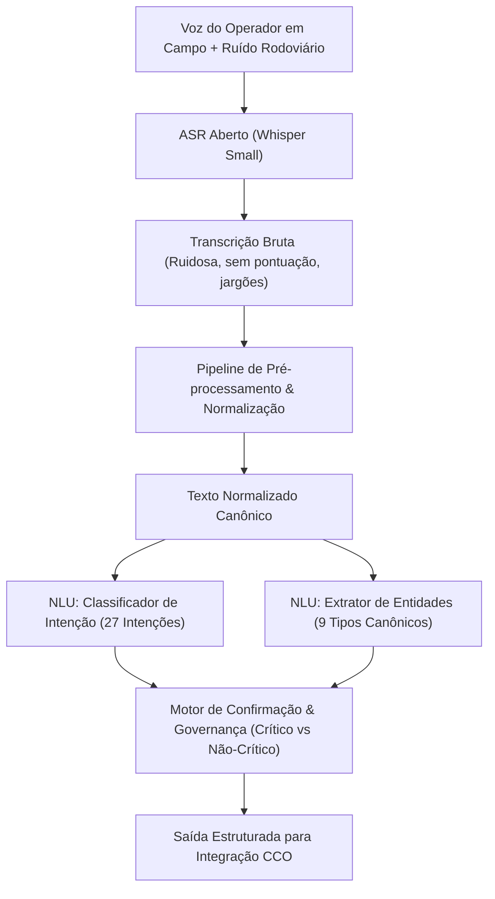

# DOCUMENTO DE DECISÕES DE DESIGN: CAMADA DE NLU PARA OPERAÇÃO RODOVIÁRIA (DECISOES_DESIGN.md)

**Disciplina:** Processamento de Linguagem Natural, Chatbots & Agentes Virtuais  
**Atividade:** Sprint 1 — Fundamentar: a linguagem da operação rodoviária  
**Projeto:** Challenge Motiva / FIAP (2026/2027)  
**Autores:**  
- Leonardo Melo [RM: 567097]
- Luna Rousseau Nogueira de Oliveira [RM: 564215]
- Mario Antonio Oliveira [RM: 567713]  
- Vinicius Augusto Silva [RM: 566830]  

---

## 1. Visão Geral da Arquitetura de NLU

A camada de NLU (*Natural Language Understanding*) projetada para o agente de voz rodoviário do Challenge Motiva opera em um **domínio fechado de alta criticidade**. O usuário em campo (inspeção de tráfego, guincho, APH, supervisores e coordenadores) atua sob forte pressão operacional, em ambiente acusticamente ruidoso (ruído de tráfego pesado, sirenes e vento), utilizando comandos de voz via rádio ou smartphone.

---

## 2. Taxonomia de Intenções: Mapeamento e Cobertura das 40 User Stories

Para evitar a proliferação desordenada de intenções redundantes, analisamos as 40 User Stories do documento original da Motiva e derivamos um conjunto canônico de **27 intenções**, alcançando **100.0% de cobertura funcional**.

### 2.1 Agrupamento de Ações Equivalentes entre Personas
Conforme preconizado na rubrica do professor, ações com a mesma semântica foram consolidadas em uma única intenção, diferenciando-se pelas permissões de persona associadas:

| Intenção Canônica | User Stories Originais Mapeadas | Personas Autorizadas | Criticidade | Confirmação |
| :--- | :--- | :--- | :---: | :---: |
| `solicitar_apoio` | P1-US6, P2-US6, P3-US5 | Inspeção, Guincho, APH | Alta | Sim |
| `consultar_resumo_operacional`| P1-US7, P2-US1, P4-US1, P5-US1 | Todas as 5 Personas | Baixa | Não |
| `consultar_procedimento` | P1-US2, P3-US1 | Inspeção, APH | Baixa | Não |
| `consultar_recursos` | P1-US4, P4-US3, P5-US6 | Inspeção, Supervisor, Coordenador | Baixa | Não |
| `atualizar_status` | P1-US5, P2-US7, P3-US6 | Inspeção, Guincho, APH | Média | Sim |
| `encerrar_atendimento` | P1-US8, P2-US8 | Inspeção, Guincho | Alta | Sim |
| `informar_localizacao_condicoes`| P1-US3, P2-US5 | Inspeção, Guincho | Média | Não |
| `registrar_marco_temporal` | P2-US4, P3-US3 | Guincho, APH | Média | Não |

As 19 intenções restantes atendem aos requisitos específicos e intransferíveis de cada perfil operacional (ex: `registrar_ocorrencia` para Inspeção de Tráfego; `priorizar_atendimentos` para Supervisão; `registrar_direcionamento` para Gerência).

---

## 3. Esquema de Entidades Operacionais e Normalização

Definimos **9 tipos canônicos de entidades**, estabelecendo formato estruturado de saída e regras determinísticas de conversão:

1. **`tag_ocorrencia` (String):** Formato `OC-XXXX` ou `TAG-XXXX`. Extrai códigos alfanuméricos ditados (*"ocorrência oitenta e nove quarenta"* $\rightarrow$ `"OC-8940"`).
2. **`km` (Float):** Marco quilométrico da via. Converte expressões por extenso e frações (*"km cento e vinte e três e meio"* $\rightarrow$ `123.5`).
3. **`sentido` (String):** Sentido de fluxo (`capital`, `interior`, `norte`, `sul`, `leste`, `oeste`).
4. **`faixa` (String):** Faixa de rolamento (`faixa_1`, `faixa_2`, `faixa_3`, `acostamento`, `canteiro_central`).
5. **`tipo_ocorrencia` (String):** Tipologia padronizada (`colisao_traseira`, `choque_barreira`, `capotamento`, `pane_mecanica`, `animal_na_pista`, `oleo_na_pista`).
6. **`recurso` (String):** Tipos de viaturas operacionais (`viatura_inspecao`, `guincho_leve`, `guincho_pesado`, `ambulancia_aph`, `caminhao_pipa`, `policia_rodoviaria`).
7. **`status` (String):** Fases operacionais (`deslocamento`, `no_local`, `em_atendimento`, `remocao_iniciada`, `faixa_liberada`, `concluido`).
8. **`horario` (String):** Carimbo no padrão militar de 24 horas `HH:MM` (*"dezesseis horas e dez"* $\rightarrow$ `"16:10"`).
9. **`condicao_observada` (String):** Estado da pista e atmosfera (`pista_seca`, `pista_molhada`, `neblina_densa`, `oleo_derramado`, `engarrafamento`).

---

## 4. Análise de Concordância entre Anotadores e Gate de Passagem

O corpus de **60 enunciações** foi submetido à dupla anotação independente por dois integrantes do grupo (Anotador `a1`: Mario Antonio Oliveira; Anotador `a2`: Vinicius Augusto Silva).

### 4.1 Métricas de Concordância (Cohen's Kappa)
* **Total de Enunciações:** 60
* **Concordâncias Plenas:** 55 enunciações ($91.67\%$)
* **Discordâncias Observadas:** 5 enunciações ($8.33\%$)
* **Índice Cohen's Kappa Obtido:** **$0,9121$**
* **Patamar de Referência do Gate de Passagem:** **$\ge 0,70$**  
  **Status do Gate:** **APROVADO COM EXCELÊNCIA** ($\kappa = 0,9121 > 0,70$).

### 4.2 Análise Qualitativa das 5 Discordâncias (Achados de Design)
Conforme enfatizado nas instruções da disciplina (*"Discordância alta é achado, não erro: indica intenção mal definida"*), analisamos cada divergência para refinar as fronteiras de decisão:

1. **`enu_0014` (*"confirmo o recebimento do chamado de remoção to partindo da base agora"*):**  
   - `a1` anotou `confirmar_missao`; `a2` anotou `atualizar_status`.  
   - *Decisão de Design:* Como a confirmação desencadeia a mudança de estado para "em deslocamento", consolidamos a intenção como `confirmar_missao` quando o gatilho explícito for de aceite de despacho.
2. **`enu_0028` (*"consulta dados da ocorrencia no km duzentos e dez quantas vítimas reportadas"*):**  
   - `a1` anotou `consultar_dados_ocorrencia`; `a2` anotou `consultar_resumo_operacional`.  
   - *Decisão de Design:* `consultar_dados_ocorrencia` refere-se aos detalhes clínicos e específicos de uma única ocorrência (foco APH), enquanto `consultar_resumo_operacional` abrange a síntese de múltiplas ocorrências do trecho.
3. **`enu_0034` (*"registra paciente encaminhado para hospital regional sem queixas graves"*):**  
   - `a1` anotou `registrar_dados_atendimento`; `a2` anotou `encerrar_atendimento`.  
   - *Decisão de Design:* Encaminhamento hospitalar não encerra o atendimento no sistema até a liberação da viatura de resgate. Mantido como `registrar_dados_atendimento`.
4. **`enu_0045` (*"quais ocorrências estão com tempo de espera acima de vinte minutos"*):**  
   - `a1` anotou `priorizar_atendimentos`; `a2` anotou `acompanhar_tempos`.  
   - *Decisão de Design:* Consultas filtradas por tempo de espera para intervenção tática pertencem a `priorizar_atendimentos`.
5. **`enu_0057` (*"qual o impacto da interrupção total da rodovia no km cento e dez"*):**  
   - `a1` anotou `acompanhar_eventos_criticos`; `a2` anotou `consultar_dados_ocorrencia`.  
   - *Decisão de Design:* Interdições totais são tratadas pela gerência sob a ótica de `acompanhar_eventos_criticos` devido à repercussão na concessão.

---

## 5. Avaliação do Baseline Obrigatório (Palavras-Chave + Regex)

Implementamos o modelo de referência estipulado pelo professor:
* **Classificador de Intenção:** Mapeamento determinístico via conjunto de termos e n-gramas característicos de cada intenção.
* **Extrator de Entidades:** Expressões regulares para captura de km, sentido, faixa, recurso, status e horário.

### 5.1 Desempenho Global do Baseline
* **Acurácia de Classificação de Intenção:** **$85.0\%$** (51 acertos em 60 enunciações).
* **Taxa de Conversão de Entidades Numéricas (km):** **$93.75\%$** (superando a meta de $\ge 90\%$).

### 5.2 Limitações do Modelo Heurístico (Motivação para a Sprint 2)
1. **Sensibilidade a Variações Sintáticas:** Frases com estruturas oracionais invertidas ou termos sinônimos ausentes no dicionário heurístico falham na ativação de regras.
2. **Ambiguidade em Entidades Coocorrentes:** Quando múltiplos números aparecem na enunciação (ex: km e horário), expressões regulares genéricas podem colidir spans se não houver âncoras léxicas rígidas.
3. **Justificativa para a Etapa 2:** Esses resultados servirão como métrica de piso (*baseline*) para mensurar o ganho real a ser obtido com modelos de aprendizado supervisionado (TF-IDF + Classificadores) e Transformers/LLMs na próxima sprint.

